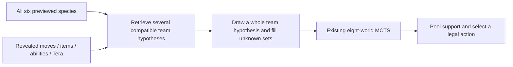

# MCTS improvement handoff: work while richer data is being curated

Prepared 25 October 2026. This is an execution plan, not a claim that these changes are implemented or beneficial. The full previous improvement plan is preserved verbatim in the appendix. The user's newer priority order below governs current execution; the original data-dependent work remains in the roadmap.

## Objective and scope

Improve our Gen 9 OU MCTS through six separately measured stages, in this order:

1. Accurate battle-state reconstruction.
2. Reliable, less overconfident belief updates.
3. Better opening leads.
4. More effective search-time allocation.
5. Evidence-backed strategic guards.
6. Optional near-tie action mixing.

For every stage, document what changed, why, how it was evaluated, whether it helped, and whether it is enabled. Keep useful correctness fixes even when a small game sample cannot establish a strength gain, but distinguish correctness from measured playing strength. Policy heuristics with inconclusive results stay experimental/off by default. Failed experiments are documented and disabled or reverted without discarding their evidence.

The persistent goal for the next chat covers these six data-independent stages, their evaluations and documentation. Curated-set integration, roster conditioning, joint team sampling and learned evaluation are explicitly deferred until new data is supplied; retaining that roadmap is part of this goal, completing the deferred work is not. Do not wait indefinitely or create a monitoring automation. A genuinely unavailable prerequisite should be documented while other independent work continues.

## Current handoff state

- Repository: https://github.com/saliha006/OxHack-2026, checkout `/home/kenar/Documents/ChatGPT/oxhack 2026/OxHack-2026`, branch `Kenar-mcts`.
- Frozen current-MCTS anchor: **`2c02fc8daa84f047ea2bddd7d0f36f6463fff1e2`**. Verify the commit exists before work. Later changes in the live branch are candidate work, not a replacement for this anchor.
- Baseline configuration: Gen9/Tera `poke-engine==0.0.48`, eight independently sampled whole-team worlds, 150 ms/world, one native thread, three-second decision ceiling, mean normalised root visit shares and deterministic selection. MCTS is already the default by user choice; one-ply remains a secondary historical comparator.
- Our active PP is exact; reconstructed bench/opponent PP defaults to 16. Some counters/durations are approximations. `decision/lead.py` uses types only. Native search has deadline isolation and streamed completed-world retention. There is no separate strategic guard or near-tie mixing policy.
- Baseline evidence is in `docs/mcts-results.md`: small 24-game pilot, not a decisive strength study. Prior next-reveal loss 2.7074, hard-filter 3.0745, posterior 3.0773 are diagnostics with pooled arms/next-move assumptions. The earlier trained model lost to HP and is not in search. Do not promote either historical claim into new evidence.
- Pending local work from the paused Tiger setup: modified `prediction/data.py`, `pyproject.toml`, `uv.lock`; new `data/tiger.py`, `prediction/tiger.py`, `tests/test_tiger.py`, `docs/tiger-setup.md`; previous plan and this handoff may also be untracked. Inspect `git status` again. Preserve these files; do not blindly reset, clean, stash, commit them into an unrelated change, or assume they are validated/finished.
- Tiger connection verified read-only/TLS, 489,840 turns / 20,000 games; its species arrays are roster proxies, not complete sets. The user **paused downloading/training** because a teammate is curating items, spreads, moves and other set details. Download was stopped and its partial raw file removed; readiness report remains under ignored `runs/tiger/`. Do not restart database access/download/training or use the credential file for these six stages.
- `.env.kenar-tiger` and the original `/home/kenar/Downloads/kenar-tiger.env` are private credential files. Never print, commit, copy into artifacts or pass their contents on a command line.
- Continue using existing local engine, priors, logs and regression teams. Do not require the promised new dataset for this phase. Coordinate with Nate's A6 rather than duplicating new team-prior work later.

Read applicable AGENTS.md, current source, `progress.md`, `docs/mcts-plan.md`, `docs/mcts-results.md`, `docs/mcts-evaluation.md`, `docs/mcts-adapter.md`, and the appendix before implementing. Some older documents contain historical default recommendations; the user has already selected MCTS as the current development default.

## Stage 0: freeze comparisons and start the record

Before changing behavior, preserve an immutable runnable baseline at the anchor commit, with pinned engine build, priors, configuration, source/engine/team hashes and a clean import boundary. Inspect existing attached worktrees before creating one. Use a separate baseline process/checkout or immutable source package; copying only the old Agent class while importing the candidate's adapter/beliefs is not a baseline. Never disturb the dirty working checkout to switch revisions.

Audit the current evaluation harness. Existing `mcts-current-pooled` compares MCTS against one-ply; it does **not** provide the required new-versus-frozen-MCTS comparison. Add only the harness support necessary to run two independently identified MCTS versions/configurations and verify both effective revisions/hashes in game artifacts. Freeze the accepted incumbent separately for incremental comparisons. For later comparisons use both:

- Candidate versus original frozen baseline: total gain since this handoff.
- Candidate versus previous accepted incumbent: contribution of this stage.

If predecessor and original baseline are identical, one comparison suffices. Preserve original baseline throughout all stages. Record actual code loaded by child processes; do not edit a running evaluation's source. Start a small smoke gate before large batches, and freeze an evaluation plan before inspecting outcomes.

Create `docs/mcts-improvement-log.md` and a machine-readable experiment index under `evaluation/mcts-improvements/`. Start collecting diagnostic loss signatures from existing logs, using wins as controls; this is measurement infrastructure. Behavioral guards remain stage 5. Existing old teams are regression history, not fresh confirmation teams.

## Stage 1: battle-state accuracy

Audit known own-bench PP, move/slot identities through switching/reordering, Protect streaks, delayed pivots/continuation requests, weather/screens/volatile durations, item loss/change, abilities and Tera. Inspect requests before assuming an own value is unavailable; keep exact supplied facts authoritative.

Reproduce concrete mismatches with request/protocol fixtures before changing the adapter. Preserve last-seen values and decrement only with supported evidence. Pressure, PP restoration, switching/reset effects, item/ability changes and unobserved moves make estimates uncertain; label that uncertainty instead of treating a guessed default as exact. Check that the reconstructed engine state agrees with Showdown for targeted turn transitions. Keep all work inside existing deadline supervision.

Deliver small isolated fixes, focused regression fixtures and trace fields distinguishing exact/remembered/estimated state. Compare targeted mismatch counts and games with baseline and predecessor. Do not bundle speculative search-policy changes into state corrections.

## Stage 2: belief reliability

Preserve hard observed moves/items/abilities/Tera across every recovery. Separate direct revelations, hard inferred exclusions and soft damage/speed evidence. Audit Choice inference against priority, speed modifiers, item changes and forced actions. Trace why candidates are removed and when fallback/recovery occurs.

Use existing local next-revelation traces and newly generated evaluation battles. Keep development positions separate from scoring positions. Compare original prior, hard-revelation-only filtering, current hard inference, and soft updates as distinct ablations. Do not count unobserved fields as ground truth or score future-revealed facts as if available earlier. Report smoothing/support failures, candidate coverage and next-reveal loss with the scorer's assumptions. Then run controlled games. Fix demonstrated bugs first; tune floors/likelihood strengths only on development evidence, not the final test pool.

## Stage 3: opening leads

Extend the type-only scorer with our actual moves, exact supplied stats, speed/priority, hazard/pivot/taunt utility and opening fragility. Use current priors for uncertain opposing sets; no new curated bank is required. Retain deterministic tie-breaking and the existing scorer as an ablation. Prevent access to the opponent's private team file; the evaluator may know it, the agent must not.

Inspect lead disagreements and early-turn outcomes as well as whole-game wins across different team styles. A better hand-designed opening score is not by itself evidence of strength. Trace score components and keep weights/configuration explicit.

## Stage 4: search-time allocation

First compare fixed budgets such as 4×300 ms, 8×150 ms and 12×100 ms at roughly 1,200 ms requested native search time, retaining one thread and the same three-second total ceiling. Requested time is not actual CPU/search work: log preparation, actual native time, visits, completed worlds and concurrency. Maintain world-sampling probabilities and per-world normalisation; more iterations must not silently give a world more prior probability.

After a fixed-budget study, separately test a bounded adaptive policy that spends extra effort when worlds disagree or root support is close. Set stopping/capping rules on development positions before game evaluation. Root support is not a calibrated win probability; it cannot directly justify a risk threshold. If continuation of a native tree is unsupported, measure restart cost rather than claiming tree reuse.

Preserve successful results if a later search stalls. Do not combine this with parallel world processes or changed pooling. Existing daemon workers cannot simply spawn process pools. Optional parallelism remains a later separate experiment and must distinguish wall-time gains from extra total CPU.

## Stage 5: conservative strategic guards

Use the accumulated loss miner to choose reproduced repeated failures: ineffective hazards, capped setup without progress, erased chip damage, switch cycles, immediate post-Tera faints and boosted-sweeper losses. Compare signature rates in wins and losses and account for exposure/opportunities. Correlation alone does not establish that the selected move was wrong.

Add one narrow flagged guard at a time, usually a tie-break or mild penalty rather than a blanket veto. Protect may scout/heal/stall; full-HP recovery can heal after a slower move; immune opponents can switch; Trick changes items; Tera can buy tempo. Create counterexample tests. Any native successor check belongs in the isolated worker within the existing budget; on failure preserve a legal search choice. Log original choice, evidence, affected actions, fallback and final choice. Never silently promote an unsupported Tera action.

## Stage 6: controlled near-tie mixing

Experiment with seeded sampling among genuinely close, sufficiently supported legal choices after earlier fixes. Keep deterministic behavior as the baseline and Tera initially deterministic. Trace eligible choices, probabilities and seed; test flat/noisy support and guard interactions. This is a heuristic mixed policy, not an equilibrium strategy, and repeatable sampling does not make native MCTS deterministic.

Compare against several opponents, including a reproducible opponent sensitive to repeated predictable choices where feasible. Avoid reporting head-to-head self-play alone as proof of resistance to exploitation. Revisit any Tera mixing rule only in a separate experiment.

## Evaluation contract for every stage

- Separate small smoke/correctness gates, development/tuning matches and confirmation matches. Run relevant meaningful tests; full suite/reliability gates at promotion points. Keep native isolation, legal actions and parent deadline intact.
- Start with at least **60 balanced screening games over at least ten fresh reserved teams** per distinct required comparison, side-swapped within team/matchup blocks and spread across styles. Expand promising variants to **200+ games** on fresh confirmation matchups; these are target sample sizes, not guarantees of significance. If resources/data provenance prevent the planned study, report exact work completed and leave strength inconclusive.
- Freeze seeds, opponent versions, team selection, rules, prior/engine hashes and stopping rules beforehand. Record mixed-policy seeds separately from simulator seeds. Pair schedules across variants; multiple turns within a battle are not independent games. Existing pilot teams are regression only. Do not fabricate fresh/held-out status or build priors from evaluation pastes. If ten suitable teams are unavailable, obtain or construct and validate them and describe what their holdout status actually means.
- Hold model/policy comparisons at the same engine, priors, world/time/thread settings and total ceiling. Stage 4 intentionally changes world/time allocation, so hold requested total search effort fixed and report actual resource differences. External opponents need matched measured compute or an explicit unmatched-compute label.
- Report wins/losses/draws/voids, side and team/style breakdowns, Wilson 95% intervals and team-cluster uncertainty; do not silently drop failed games. Report actual search/CPU time, preparation and p50/p95/p99/max latency, requested/completed/usable/failed worlds, fallbacks, rejected actions, recovery/restart causes and the targeted mechanism metric. Sparse team clusters limit uncertainty estimates.
- Compare original baseline and predecessor. Keep unsuccessful stage flags off in subsequent stages. Freeze a new accepted-incumbent hash only after recording the decision. Finish with the accepted cumulative bot against the original baseline and a relevant opponent panel.
- Use honest verdicts: **correctness improved; strength unknown**, **promising but inconclusive**, **strength improvement supported on this evaluation**, **no detected benefit**, or **regressed**. Publish the practical limit of each conclusion. A 4-game win streak, offline loss reduction or regression-test pass is not a general strength result.

## Live documentation and handoff artifacts

Maintain short live explanations in plain English as work proceeds: what problem was found, what is changing, what comparison is running, and what its result means. A documentation subagent may own the readable log and results narrative if one is available; it must use actual implementation/test artifacts, and the primary implementer owns correctness. Do not let it edit runtime code or invent measurements. The user previously requested a documentation subagent for this project.

For each stage, append an entry to `docs/mcts-improvement-log.md` with:

| Field | Required content |
|---|---|
| Identity | Stage/flag, candidate commit/source hash, original baseline, previous incumbent |
| Problem and motivation | A concrete understandable example; what already existed |
| Change | Exact behavior changed, files, configuration, supported facts vs estimates |
| Verification | Regression fixtures/tests and meaningful integration results |
| Comparison | Opponents, teams/provenance, seeds, game count, compute, artifact paths |
| Results | Before/after targeted metric, W/L/draw/voids, intervals, reliability/latency |
| Interpretation | Did it help? What evidence supports that? What remains unknown? |
| Decision | Enabled, correctness fix with unproven strength, experimental/off, revised or rejected |
| Reproduction | Commands and immutable manifests; next action |

Record unsuccessful experiments as well as successes. Use fresh output paths and preserve raw logs locally under ignored `runs/`; commit compact manifests/results and readable summaries without credentials. Update `progress.md` and appropriate project docs in accordance with repository instructions and the user's branch scope, preserving others' entries. Keep the original plan and the appendix intact; annotate changed statuses in a separate current-status section, never overwrite historical results. Make focused commits on the implementation branch and preserve unrelated pending Tiger work.

## Deferred roadmap: carry forward, do not discard

When richer data is supplied, inspect its actual schema, source provenance, confirmed/inferred labels and availability timing before integration. Complete sets should include species/form, moves, item, ability, nature, EVs, IVs and Tera where known. Never fill an unobserved field as ground truth.

Resume the original coherent set-bank → roster-conditioned priors → joint team-sampling sequence, preserving broad fallback, observed-fact authority, full-roster matching and separate ablations. Reuse Nate's A6 if implemented. Retain the HolidayOugi assessment, deduplication, rules/date validation and player/roster leakage controls. Complete team identity and preview roster identity remain different. Learn/train/calibrate on earlier disjoint data; report familiar- and novel-roster performance separately. Keep databases and corpus scans outside decisions.

Learned OU evaluation, explicit pooling/risk alternatives, parallel worlds and native evaluator changes remain separate later experiments. A forecast must beat constant/HP baselines first and then pass a separate battle-strength comparison. Do not copy Random Battle weights into OU or claim a Python leaf-value hook exists in the stock engine. The full detailed requirements and pinned Laplace references follow unchanged.

---

## Appendix: original MCTS improvement plan, verbatim

Original source: `docs/mcts-improvement-plan.md`.
Original SHA-256: `8d5a8debcc2c3597f5d6abb84c0dccb2f34602e92f5b7c0f4399ed6e2a73172f`.

# Improving the Gen9 OU MCTS bot

Status: proposed plan, 25 October 2026. This document changes no battle behavior.

Our reviewed implementation is `Kenar-mcts` at `2c02fc8`. Laplace's reviewed source is `4053b5f9fd9159e6b9b4fd794af8f195fce45811` on `master`. Remote project context was refreshed: `origin/main` is `85d7521`; its later backtest work has not been merged into this branch. Source findings below refer to the reviewed versions, not an assumed future release.

## Recommendation

Make the opponent teams searched by MCTS more realistic, then use replay evidence to address repeated decision failures. The search framework already resembles Laplace's core. The largest new opportunity is coherent hidden sets conditioned on the opponent's entire previewed team.

In normal Gen9 OU, preview already identifies all six opposing species. Team recognition should infer their likely sets and roles: moves, items, abilities, spreads and Tera types. A single familiar species is weak evidence; the full roster and subsequent revelations are much more useful. Keep several hypotheses because the same six species can run different sets.

## What is already implemented?

| Idea | Our current bot | Laplace source finding |
|---|---|---|
| Eight sampled hidden worlds, 150 ms native MCTS each | Yes; default, one engine thread, three-second decision ceiling | Shipped stock ladder configuration also uses 8 ×150 ms, with eight native threads |
| Whole opponent team represented in each world | Yes; species fixed to preview; each Pokémon's set sampled independently | OU adapter retains previewed roster and builds all six |
| Normalised root visit shares averaged across worlds | Yes | Shipped ladder sets `robust_vote=False`, using average shares too; class also contains a world-winner-voting alternative |
| OU priors with EVs/natures, items, moves, abilities and Tera | Yes; candidates are built from Smogon usage marginals | OU sampler mixes curated Smogon role sets with usage-marginal draws |
| Revealed-info filtering and damage/speed inference | Yes, with floors and recorded recovery; quality needs improvement | Move history, item/hazard and speed inference exist; OU uses speed bounds rather than fixed RandBats spreads |
| Real jointly observed/curated set relationships | Partial: complete candidate records exist, but their builder combines marginal fields and truncates to at most 30 per species | Curated set sampling preserves relationships within a Pokémon's role; Random Battle also has counted joint-set support |
| Full-roster matching to common complete team templates | No on this branch; planned in project notes as A6 | Not found in the normal OU sampler. Teammate species sampling is a fallback when preview information is missing |
| Separate strategic no-op/loop/immunity guards | No; current policy performs action legality filtering | Implemented as configurable decision stages with attribution |
| Deliberate randomisation among near-tied root actions | No; stable argmax | Enabled by shipped ladder configuration with `mix_root=True, mix_frac=0.9` and restrictions on Tera/vetoed moves |
| Lead choice using actual moves, speed and opening roles | Partial: our lead scorer is type-matchup-only | OU lead scorer also prices damage estimates, speed and hazard/pivot roles |
| Loss-pattern mining with wins as controls | Partial: detailed traces and diagnostic scores exist; no automated pattern miner | `analysis/mine_losses.py` groups repeated failure signatures and reports mechanism counters |
| Learned model influencing OU search | No; our prediction model stays separate and lost to HP on its test set | Shipped OU profile explicitly disables the Random Battle value network |
| Concurrent searches across worlds | No; one isolated sequential worker | An optional process-pool path exists; shipped `build_agent` does not enable `parallel_worlds` |

Do not interpret Laplace's headline ladder rating as an OU result: its README attributes that rating to Random Battle and describes OU as unproven. The code is useful inspiration without establishing that every component will improve our bot.

## Workstream 1: diagnose losses and repair state/inference errors

Use the current MCTS commit as a frozen baseline. Build a small analysis tool over our existing request/state/visits/observation traces, inspired by Laplace's loss miner. Count repeated no-progress moves, failed setup, ineffective attacks, switch cycles, Tera followed by an immediate faint, and losses to boosted sweepers. Compare rates in wins and losses, then reproduce positions before deciding the cause. A correlation is a lead for investigation, not proof that a particular move was wrong.

Audit the fields implicated by those positions. Start with remembered own-bench PP, Protect streaks, delayed pivot continuations, and uncertain duration/ability/item changes. Our active PP is exact, but reconstructed bench/opponent PP currently defaults to 16. Preserve known last-seen values and explicitly mark estimates when Pressure, PP-changing effects or hidden information prevent certainty. Keep slot identities stable through request reordering.

Re-evaluate belief filtering on held-out next revelations. In the pilot, the original prior's loss was 2.7074, hard filtering 3.0745 and recorded posteriors 3.0773. The metric pools experimental arms and uses an explicit next-move assumption; use it to locate exclusions and recovery failures rather than claim every inference rule is harmful. Compare hard revelations, inferred item rules and noisy damage/speed updates separately. Model item changes and priority/speed modifiers before drawing Choice conclusions.

Acceptance: replay fixtures reproduce each targeted defect; observed facts stay intact; no legality/deadline regression; fewer targeted mechanism failures in controlled games. Proposed files: `analysis/mine_losses.py`, focused changes in `decision/belief.py`, `decision/state.py`, `decision/adapter.py`, parser and tests as evidence requires.

## Workstream 2: coherent sets and team-conditioned hypotheses

### 2A. A coherent per-Pokémon set bank

Add curated OU role sets alongside the broad usage prior, following Laplace's OU approach. A role keeps related moves, item, nature, EVs/IVs and Tera together. Usage supplies frequency information and covers sets/items that the curated bank misses. Our present complete set records are not evidence that their fields were jointly observed: `build_set_candidates.py` constructs combinations from marginal categories.

Preserve alternative legal move-slot options when resolving a curated role. Do not ban status moves merely because a Choice item is present: Trick/Switcheroo and other legal combinations must remain representable. Keep confirmed revelations authoritative; if the bank cannot explain them, back off to a broader compatible model and record that event. Do not copy a fallback that silently ignores a confirmed contradiction.

A curated/usage mixture is an experimental parameter. Laplace's 50/50 is a starting configuration in its code, not a universally optimal ratio. Choose ours on validation data and retain a nonzero broad fallback for unusual sets.

Acceptance: improved next-reveal scores/coverage and fewer impossible or implausible combinations, followed by a fixed-compute game comparison. Measure full-set coverage only for examples with actual known sets. Proposed files: `data/pipeline/build_curated_sets.py`, `contracts/team_hypotheses.py` or a small set-bank contract, `decision/set_priors.py`.

### 2B. Build a recent OU team index

Combine public team exports with roster/set evidence from the existing HolidayOugi pipeline. Complete exports supply actual complete templates; ordinary replays supply partial observations and roster frequencies. An unseen move, item, EV spread or Tera type remains unknown. Missing data must never be filled in as ground truth. Validate imported complete teams against a pinned Gen9 OU ruleset, and retain source date/rules metadata.

Canonicalise species/formes, ignore team order and nicknames for roster matching, and retain set variants as distinct hypotheses. Separate species roster identity from complete set identity. Deduplicate team exports and repeated battles; a heavily repeated uploader/player must not overwhelm the estimate. Replay upload frequency is not a direct measurement of all ladder usage.

Index by all six previewed species. Retrieve exact-roster matches first. If support is weak, gradually back off through five/four-species overlap, teammate/role evidence, and finally the coherent per-species/global usage prior. The project's A6 notes already propose matching progressively fewer teammates; inspect/reuse any new data-layer implementation before duplicating it. Current inspected runtime code has no such lookup.

For a roster containing sun-setting and sun-dependent species, for example, the roster should increase support for sun-compatible roles/spreads. This is a qualitative illustration, not a measured probability or a guarantee of an exact team identity.

### 2C. Sample globally consistent teams

An initial milestone can reweight each Pokémon's candidate distribution using its teammates. Mark that milestone as team-conditioned marginals: it still does not preserve all correlations across six sets.

The full design maintains probabilities over compatible complete/partial team templates. Draw one team hypothesis for a world, then fill its unknown fields from compatible set-bank distributions. This keeps complementary roles together, rather than independently selecting every member from a different template. On each new revelation, update the hypotheses and preserve a broader fallback if the real team is missing from the library.

The library supplies hypotheses; MCTS still selects the move. Search continues to consider setup, recovery, Protect, switches and Tera. Keep per-world visit normalisation. Sampled occurrences already reflect their sampling distribution, so do not multiply their prior probability into the pool again. If stratified sampling deliberately changes component counts, account explicitly for the chosen mixture rather than accidentally reweighting it.

Load a compact, versioned library locally and cache roster retrieval in the persistent worker. No network requests or full replay-corpus scans during a decision. All new preparation stays inside the existing parent-enforced deadline. Trace retrieved template IDs, evidence, component/fallback weights, missing fields and sampled worlds.

Acceptance: reveals never contradicted; same seed gives the same sampled worlds; distributions do not collapse to one familiar team without support; useful behavior on unknown rosters; no increased rejected-choice/fallback/deadline rate. Offline tests report next-reveal loss, known-set coverage where available, support/recovery and unseen-roster behavior. Game arms isolate curated-only improvement from the additional effect of roster conditioning/joint sampling. Proposed files: `data/pipeline/build_team_hypotheses.py`, `decision/team_prior.py`, an extension to `Belief.sample_worlds`, and focused fixtures.

## Workstream 3: conservative blunder guards

Borrow Laplace's reproducible-failure loop and explicit decision-stage tracing. Start with diagnostics, then add each narrowly justified guard behind its own flag. Candidate checks include repeated hazard failure, capped setup without progress, repeatedly erased chip damage, and choices that cannot affect the relevant position.

Avoid blanket rules. Full-HP recovery can be useful if a slower Pokémon heals after taking damage; Protect can scout, gain residual recovery or affect delayed moves; a currently immune opponent can switch; Trick can change a Choice item; Tera can buy immediate tempo. Laplace's modal-reply no-op and immunity demotions are heuristics, not proofs over every possible reply. Validate them against our worlds and regression counterexamples before adopting them. Prefer a small tie-break/penalty unless the stronger claim is established.

Run any native successor checks in the isolated worker with a reserved share of the same three-second budget. A guard timeout/error must leave a legal search choice available. Record the original winner, guard evidence, alternatives and final action; never silently promote a previously low-support Tera option.

Acceptance: fewer reproduced failure signatures without a compensating increase in other loss types; fresh head-to-head results against the frozen MCTS baseline. Proposed file: `decision/search_guards.py`; no unrelated changes to search or priors in the same experiment.

## Workstream 4: improve team preview

Extend `pick_lead()` using our actual moves/stats, likely opposing moves/spreads from the new prior, speed/priority, hazard/pivot/taunt roles and lead fragility. Laplace's `ou/teampreview.py` is a useful starting design. Keep preview separate from turn search, and permit a deliberate team-specific fixed lead when testing builder intent.

Acceptance: compare lead choices with the type-only baseline, inspect early-turn failure/position metrics and whole-game results across multiple teams. A better opening score alone does not prove a higher win rate.

## Workstream 5: experiment with controlled root mixing

Laplace's shipped configuration samples among sufficiently supported near-tied candidates; our policy currently chooses the largest support with a stable tie-break. Add seeded near-tie randomisation behind a flag after the preceding fixes. Retain legality/guard filtering, log eligible actions and probabilities, and initially keep Tera decisions deterministic as a safety control. Treat this as a heuristic mixed policy, not a computed game-theoretic equilibrium. Revisit the Tera constraint in its own experiment because unnecessary restraint can also lose tempo.

Acceptance: compare deterministic vs mixed selection at the same state model/search budget against several opponents, including repeatable opponents capable of exploiting predictable behavior. Test flat/noisy support cases; randomising among bad actions is not an improvement.

## Later experiments

- **Parallel worlds/adaptive compute:** optional process parallelism or spending time when action support is unstable across worlds. Preserve deadline supervision and successful-world retention; the current daemon worker cannot simply spawn another process pool. Use one native thread per search worker first and distinguish equal wall time from equal total CPU/search work. Our 1/2/4-thread test increased visits but did not divide sequential wall time.
- **Learned OU evaluation:** train/evaluate an OU-specific model only after it beats constant/HP baselines on held-out data. A better forecast still needs a separate playing-strength test when used to rerank. Laplace disables its Random Battle value net for OU; copying those weights would transfer the wrong distribution. Stock poke-engine does not expose a Python leaf-evaluation hook, so native integration and an external reranker are separate engineering choices.
- **Alternative pooling/risk models:** compare mean root shares with world-winner voting or explicit risk controls only as separate experiments. The shipped Laplace ladder already uses mean shares; replacing our pooling is not necessary to match its current main path.

## Evaluation and delivery order

Freeze `2c02fc8` as the MCTS baseline. Keep engine version, our teams, world count, per-world time, native threads and decision ceiling fixed when testing a model/policy change. Start with at least 60 balanced screening games across at least ten fresh reserved teams, then expand promising variants to 200+ games; neither count guarantees significance. Report confidence intervals and team-cluster uncertainty, actual search/CPU time, completed worlds, rejected choices, fallback/recovery causes and p50/p95/p99 latency. Use matched practical compute for external opponents; our previous Foul Play pilot had unmatched compute.

Train and tune only on earlier battles/templates. Reserve whole later games, prevent repeated-player/team leakage, and report both familiar-roster and genuinely novel-roster test subsets. Exact roster retrieval can legitimately help on familiar rosters, but that is a different claim from generalising to new teams. Avoid building the template bank from evaluation pastes, or using future revelations as pre-turn features. Our four earlier reserved sample teams are now regression history and must not be relabelled as new confirmation data.

Delivery order: **loss/state audit → coherent set bank → roster-conditioned priors → joint team sampling → targeted guards → preview improvements → near-tie mixing**. Parallelism and learned search evaluation remain later experiments. Each change has a flag, its own baseline comparison, a regression position set and a measured promotion decision. Reject or revise plausible ideas that fail their tests.

## Source pointers

Laplace links are pinned to the inspected commit:

- [OU mixture and roster construction](https://github.com/influxtion/Laplace-Pokemon-Showdown-AI/blob/4053b5f9fd9159e6b9b4fd794af8f195fce45811/src/laplace/ou/adapter.py): `CURATED_FRACTION`, `_opp_pokemon`, `_opp_side`.
- [OU set bank and teammate fallback](https://github.com/influxtion/Laplace-Pokemon-Showdown-AI/blob/4053b5f9fd9159e6b9b4fd794af8f195fce45811/src/laplace/ou/usage.py): `UsageStats.teammate`, `CuratedSets._weights`, `CuratedSets.sample`.
- [Search, guard pipeline and mixed root](https://github.com/influxtion/Laplace-Pokemon-Showdown-AI/blob/4053b5f9fd9159e6b9b4fd794af8f195fce45811/src/laplace/agent/engine_search.py): `_pooled_policy`, `choose_move`, `_mix_sample`, `_noop_demote`, `_futility_demote`.
- [Shipped settings and disabled OU net](https://github.com/influxtion/Laplace-Pokemon-Showdown-AI/blob/4053b5f9fd9159e6b9b4fd794af8f195fce45811/src/laplace/cli/ladder.py): `FORMATS`, `build_agent`.
- [Lead scoring](https://github.com/influxtion/Laplace-Pokemon-Showdown-AI/blob/4053b5f9fd9159e6b9b4fd794af8f195fce45811/src/laplace/ou/teampreview.py): `score_lead`.
- [Loss analysis](https://github.com/influxtion/Laplace-Pokemon-Showdown-AI/blob/4053b5f9fd9159e6b9b4fd794af8f195fce45811/src/laplace/analysis/mine_losses.py): `analyze_dir`, signature/mechanism reporting.

Our source: `decision/belief.py` (`sample_worlds`), `decision/search_policy.py` (`pool_results`), `decision/lead.py` (`pick_lead`), `data/pipeline/build_set_candidates.py` (`species_entry`). Evidence/limitations: `docs/mcts-results.md`, `docs/mcts-adapter.md`. Team-conditioning coordination: `progress.md` A6 entries and current data-layer work; planned status is not implementation evidence.
