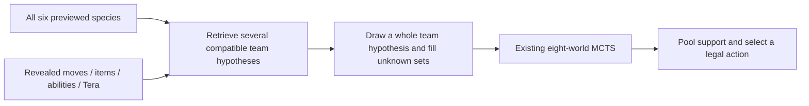

# Improving the Gen9 OU MCTS bot

Status: proposed plan, 25 October 2026. This document changes no battle behavior.

Our reviewed implementation is `Kenar-mcts` at `2c02fc8`. Laplace's reviewed source is `4053b5f9fd9159e6b9b4fd794af8f195fce45811` on `master`. Remote project context was refreshed: `origin/main` is `85d7521`; its later backtest work has not been merged into this branch. Source findings below refer to the reviewed versions, not an assumed future release.

## Recommendation

Make the opponent teams searched by MCTS more realistic, then use replay evidence to address repeated decision failures. The search framework already resembles Laplace's core. The largest new opportunity is coherent hidden sets conditioned on the opponent's entire previewed team.

In normal Gen9 OU, preview already identifies all six opposing species. Team recognition should infer their likely sets and roles: moves, items, abilities, spreads and Tera types. A single familiar species is weak evidence; the full roster and subsequent revelations are much more useful. Keep several hypotheses because the same six species can run different sets.

## What is already implemented?

| Idea | Our current bot | Laplace source finding |
|---|---|---|
| Eight sampled hidden worlds, 150 ms native MCTS each | Yes; default, one engine thread, three-second decision ceiling | Shipped stock ladder configuration also uses 8 ×150 ms, with eight native threads |
| Whole opponent team represented in each world | Yes; species fixed to preview; each Pokémon's set sampled independently | OU adapter retains previewed roster and builds all six |
| Normalised root visit shares averaged across worlds | Yes | Shipped ladder sets `robust_vote=False`, using average shares too; class also contains a world-winner-voting alternative |
| OU priors with EVs/natures, items, moves, abilities and Tera | Yes; candidates are built from Smogon usage marginals | OU sampler mixes curated Smogon role sets with usage-marginal draws |
| Revealed-info filtering and damage/speed inference | Yes, with floors and recorded recovery; quality needs improvement | Move history, item/hazard and speed inference exist; OU uses speed bounds rather than fixed RandBats spreads |
| Real jointly observed/curated set relationships | Partial: complete candidate records exist, but their builder combines marginal fields and truncates to at most 30 per species | Curated set sampling preserves relationships within a Pokémon's role; Random Battle also has counted joint-set support |
| Full-roster matching to common complete team templates | No on this branch; planned in project notes as A6 | Not found in the normal OU sampler. Teammate species sampling is a fallback when preview information is missing |
| Separate strategic no-op/loop/immunity guards | No; current policy performs action legality filtering | Implemented as configurable decision stages with attribution |
| Deliberate randomisation among near-tied root actions | No; stable argmax | Enabled by shipped ladder configuration with `mix_root=True, mix_frac=0.9` and restrictions on Tera/vetoed moves |
| Lead choice using actual moves, speed and opening roles | Partial: our lead scorer is type-matchup-only | OU lead scorer also prices damage estimates, speed and hazard/pivot roles |
| Loss-pattern mining with wins as controls | Partial: detailed traces and diagnostic scores exist; no automated pattern miner | `analysis/mine_losses.py` groups repeated failure signatures and reports mechanism counters |
| Learned model influencing OU search | No; our prediction model stays separate and lost to HP on its test set | Shipped OU profile explicitly disables the Random Battle value network |
| Concurrent searches across worlds | No; one isolated sequential worker | An optional process-pool path exists; shipped `build_agent` does not enable `parallel_worlds` |

Do not interpret Laplace's headline ladder rating as an OU result: its README attributes that rating to Random Battle and describes OU as unproven. The code is useful inspiration without establishing that every component will improve our bot.

## Workstream 1: diagnose losses and repair state/inference errors

Use the current MCTS commit as a frozen baseline. Build a small analysis tool over our existing request/state/visits/observation traces, inspired by Laplace's loss miner. Count repeated no-progress moves, failed setup, ineffective attacks, switch cycles, Tera followed by an immediate faint, and losses to boosted sweepers. Compare rates in wins and losses, then reproduce positions before deciding the cause. A correlation is a lead for investigation, not proof that a particular move was wrong.

Audit the fields implicated by those positions. Start with remembered own-bench PP, Protect streaks, delayed pivot continuations, and uncertain duration/ability/item changes. Our active PP is exact, but reconstructed bench/opponent PP currently defaults to 16. Preserve known last-seen values and explicitly mark estimates when Pressure, PP-changing effects or hidden information prevent certainty. Keep slot identities stable through request reordering.

Re-evaluate belief filtering on held-out next revelations. In the pilot, the original prior's loss was 2.7074, hard filtering 3.0745 and recorded posteriors 3.0773. The metric pools experimental arms and uses an explicit next-move assumption; use it to locate exclusions and recovery failures rather than claim every inference rule is harmful. Compare hard revelations, inferred item rules and noisy damage/speed updates separately. Model item changes and priority/speed modifiers before drawing Choice conclusions.

Acceptance: replay fixtures reproduce each targeted defect; observed facts stay intact; no legality/deadline regression; fewer targeted mechanism failures in controlled games. Proposed files: `analysis/mine_losses.py`, focused changes in `decision/belief.py`, `decision/state.py`, `decision/adapter.py`, parser and tests as evidence requires.

## Workstream 2: coherent sets and team-conditioned hypotheses

### 2A. A coherent per-Pokémon set bank

Add curated OU role sets alongside the broad usage prior, following Laplace's OU approach. A role keeps related moves, item, nature, EVs/IVs and Tera together. Usage supplies frequency information and covers sets/items that the curated bank misses. Our present complete set records are not evidence that their fields were jointly observed: `build_set_candidates.py` constructs combinations from marginal categories.

Preserve alternative legal move-slot options when resolving a curated role. Do not ban status moves merely because a Choice item is present: Trick/Switcheroo and other legal combinations must remain representable. Keep confirmed revelations authoritative; if the bank cannot explain them, back off to a broader compatible model and record that event. Do not copy a fallback that silently ignores a confirmed contradiction.

A curated/usage mixture is an experimental parameter. Laplace's 50/50 is a starting configuration in its code, not a universally optimal ratio. Choose ours on validation data and retain a nonzero broad fallback for unusual sets.

Acceptance: improved next-reveal scores/coverage and fewer impossible or implausible combinations, followed by a fixed-compute game comparison. Measure full-set coverage only for examples with actual known sets. Proposed files: `data/pipeline/build_curated_sets.py`, `contracts/team_hypotheses.py` or a small set-bank contract, `decision/set_priors.py`.

### 2B. Build a recent OU team index

Combine public team exports with roster/set evidence from the existing HolidayOugi pipeline. Complete exports supply actual complete templates; ordinary replays supply partial observations and roster frequencies. An unseen move, item, EV spread or Tera type remains unknown. Missing data must never be filled in as ground truth. Validate imported complete teams against a pinned Gen9 OU ruleset, and retain source date/rules metadata.

Canonicalise species/formes, ignore team order and nicknames for roster matching, and retain set variants as distinct hypotheses. Separate species roster identity from complete set identity. Deduplicate team exports and repeated battles; a heavily repeated uploader/player must not overwhelm the estimate. Replay upload frequency is not a direct measurement of all ladder usage.

Index by all six previewed species. Retrieve exact-roster matches first. If support is weak, gradually back off through five/four-species overlap, teammate/role evidence, and finally the coherent per-species/global usage prior. The project's A6 notes already propose matching progressively fewer teammates; inspect/reuse any new data-layer implementation before duplicating it. Current inspected runtime code has no such lookup.

For a roster containing sun-setting and sun-dependent species, for example, the roster should increase support for sun-compatible roles/spreads. This is a qualitative illustration, not a measured probability or a guarantee of an exact team identity.

### 2C. Sample globally consistent teams

An initial milestone can reweight each Pokémon's candidate distribution using its teammates. Mark that milestone as team-conditioned marginals: it still does not preserve all correlations across six sets.

The full design maintains probabilities over compatible complete/partial team templates. Draw one team hypothesis for a world, then fill its unknown fields from compatible set-bank distributions. This keeps complementary roles together, rather than independently selecting every member from a different template. On each new revelation, update the hypotheses and preserve a broader fallback if the real team is missing from the library.

The library supplies hypotheses; MCTS still selects the move. Search continues to consider setup, recovery, Protect, switches and Tera. Keep per-world visit normalisation. Sampled occurrences already reflect their sampling distribution, so do not multiply their prior probability into the pool again. If stratified sampling deliberately changes component counts, account explicitly for the chosen mixture rather than accidentally reweighting it.

Load a compact, versioned library locally and cache roster retrieval in the persistent worker. No network requests or full replay-corpus scans during a decision. All new preparation stays inside the existing parent-enforced deadline. Trace retrieved template IDs, evidence, component/fallback weights, missing fields and sampled worlds.

Acceptance: reveals never contradicted; same seed gives the same sampled worlds; distributions do not collapse to one familiar team without support; useful behavior on unknown rosters; no increased rejected-choice/fallback/deadline rate. Offline tests report next-reveal loss, known-set coverage where available, support/recovery and unseen-roster behavior. Game arms isolate curated-only improvement from the additional effect of roster conditioning/joint sampling. Proposed files: `data/pipeline/build_team_hypotheses.py`, `decision/team_prior.py`, an extension to `Belief.sample_worlds`, and focused fixtures.

## Workstream 3: conservative blunder guards

Borrow Laplace's reproducible-failure loop and explicit decision-stage tracing. Start with diagnostics, then add each narrowly justified guard behind its own flag. Candidate checks include repeated hazard failure, capped setup without progress, repeatedly erased chip damage, and choices that cannot affect the relevant position.

Avoid blanket rules. Full-HP recovery can be useful if a slower Pokémon heals after taking damage; Protect can scout, gain residual recovery or affect delayed moves; a currently immune opponent can switch; Trick can change a Choice item; Tera can buy immediate tempo. Laplace's modal-reply no-op and immunity demotions are heuristics, not proofs over every possible reply. Validate them against our worlds and regression counterexamples before adopting them. Prefer a small tie-break/penalty unless the stronger claim is established.

Run any native successor checks in the isolated worker with a reserved share of the same three-second budget. A guard timeout/error must leave a legal search choice available. Record the original winner, guard evidence, alternatives and final action; never silently promote a previously low-support Tera option.

Acceptance: fewer reproduced failure signatures without a compensating increase in other loss types; fresh head-to-head results against the frozen MCTS baseline. Proposed file: `decision/search_guards.py`; no unrelated changes to search or priors in the same experiment.

## Workstream 4: improve team preview

Extend `pick_lead()` using our actual moves/stats, likely opposing moves/spreads from the new prior, speed/priority, hazard/pivot/taunt roles and lead fragility. Laplace's `ou/teampreview.py` is a useful starting design. Keep preview separate from turn search, and permit a deliberate team-specific fixed lead when testing builder intent.

Acceptance: compare lead choices with the type-only baseline, inspect early-turn failure/position metrics and whole-game results across multiple teams. A better opening score alone does not prove a higher win rate.

## Workstream 5: experiment with controlled root mixing

Laplace's shipped configuration samples among sufficiently supported near-tied candidates; our policy currently chooses the largest support with a stable tie-break. Add seeded near-tie randomisation behind a flag after the preceding fixes. Retain legality/guard filtering, log eligible actions and probabilities, and initially keep Tera decisions deterministic as a safety control. Treat this as a heuristic mixed policy, not a computed game-theoretic equilibrium. Revisit the Tera constraint in its own experiment because unnecessary restraint can also lose tempo.

Acceptance: compare deterministic vs mixed selection at the same state model/search budget against several opponents, including repeatable opponents capable of exploiting predictable behavior. Test flat/noisy support cases; randomising among bad actions is not an improvement.

## Later experiments

- **Parallel worlds/adaptive compute:** optional process parallelism or spending time when action support is unstable across worlds. Preserve deadline supervision and successful-world retention; the current daemon worker cannot simply spawn another process pool. Use one native thread per search worker first and distinguish equal wall time from equal total CPU/search work. Our 1/2/4-thread test increased visits but did not divide sequential wall time.
- **Learned OU evaluation:** train/evaluate an OU-specific model only after it beats constant/HP baselines on held-out data. A better forecast still needs a separate playing-strength test when used to rerank. Laplace disables its Random Battle value net for OU; copying those weights would transfer the wrong distribution. Stock poke-engine does not expose a Python leaf-evaluation hook, so native integration and an external reranker are separate engineering choices.
- **Alternative pooling/risk models:** compare mean root shares with world-winner voting or explicit risk controls only as separate experiments. The shipped Laplace ladder already uses mean shares; replacing our pooling is not necessary to match its current main path.

## Evaluation and delivery order

Freeze `2c02fc8` as the MCTS baseline. Keep engine version, our teams, world count, per-world time, native threads and decision ceiling fixed when testing a model/policy change. Start with at least 60 balanced screening games across at least ten fresh reserved teams, then expand promising variants to 200+ games; neither count guarantees significance. Report confidence intervals and team-cluster uncertainty, actual search/CPU time, completed worlds, rejected choices, fallback/recovery causes and p50/p95/p99 latency. Use matched practical compute for external opponents; our previous Foul Play pilot had unmatched compute.

Train and tune only on earlier battles/templates. Reserve whole later games, prevent repeated-player/team leakage, and report both familiar-roster and genuinely novel-roster test subsets. Exact roster retrieval can legitimately help on familiar rosters, but that is a different claim from generalising to new teams. Avoid building the template bank from evaluation pastes, or using future revelations as pre-turn features. Our four earlier reserved sample teams are now regression history and must not be relabelled as new confirmation data.

Delivery order: **loss/state audit → coherent set bank → roster-conditioned priors → joint team sampling → targeted guards → preview improvements → near-tie mixing**. Parallelism and learned search evaluation remain later experiments. Each change has a flag, its own baseline comparison, a regression position set and a measured promotion decision. Reject or revise plausible ideas that fail their tests.

## Source pointers

Laplace links are pinned to the inspected commit:

- [OU mixture and roster construction](https://github.com/influxtion/Laplace-Pokemon-Showdown-AI/blob/4053b5f9fd9159e6b9b4fd794af8f195fce45811/src/laplace/ou/adapter.py): `CURATED_FRACTION`, `_opp_pokemon`, `_opp_side`.
- [OU set bank and teammate fallback](https://github.com/influxtion/Laplace-Pokemon-Showdown-AI/blob/4053b5f9fd9159e6b9b4fd794af8f195fce45811/src/laplace/ou/usage.py): `UsageStats.teammate`, `CuratedSets._weights`, `CuratedSets.sample`.
- [Search, guard pipeline and mixed root](https://github.com/influxtion/Laplace-Pokemon-Showdown-AI/blob/4053b5f9fd9159e6b9b4fd794af8f195fce45811/src/laplace/agent/engine_search.py): `_pooled_policy`, `choose_move`, `_mix_sample`, `_noop_demote`, `_futility_demote`.
- [Shipped settings and disabled OU net](https://github.com/influxtion/Laplace-Pokemon-Showdown-AI/blob/4053b5f9fd9159e6b9b4fd794af8f195fce45811/src/laplace/cli/ladder.py): `FORMATS`, `build_agent`.
- [Lead scoring](https://github.com/influxtion/Laplace-Pokemon-Showdown-AI/blob/4053b5f9fd9159e6b9b4fd794af8f195fce45811/src/laplace/ou/teampreview.py): `score_lead`.
- [Loss analysis](https://github.com/influxtion/Laplace-Pokemon-Showdown-AI/blob/4053b5f9fd9159e6b9b4fd794af8f195fce45811/src/laplace/analysis/mine_losses.py): `analyze_dir`, signature/mechanism reporting.

Our source: `decision/belief.py` (`sample_worlds`), `decision/search_policy.py` (`pool_results`), `decision/lead.py` (`pick_lead`), `data/pipeline/build_set_candidates.py` (`species_entry`). Evidence/limitations: `docs/mcts-results.md`, `docs/mcts-adapter.md`. Team-conditioning coordination: `progress.md` A6 entries and current data-layer work; planned status is not implementation evidence.
