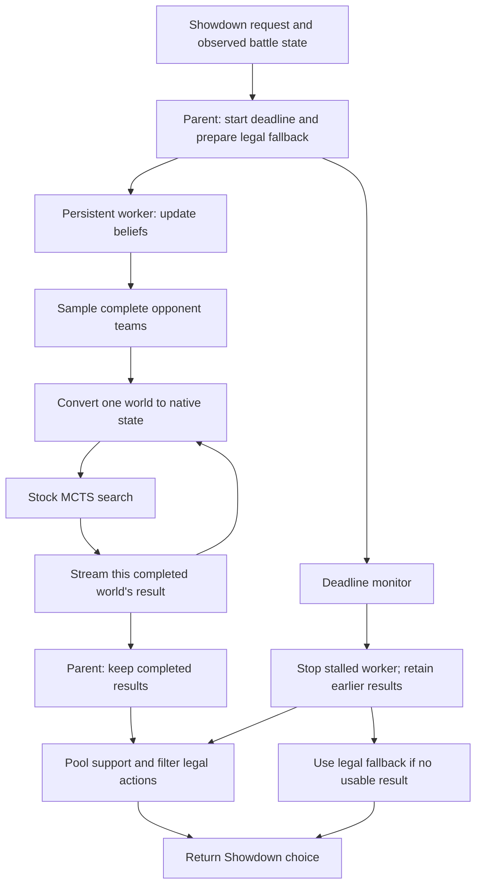

# Kenar's live MCTS walkthrough

This is the running explanation of `Kenar-mcts`: what is changing, why each part exists, and what the evidence currently says. The implementation and measurements are continuing alongside this document. Numbers below refer to completed, checked runs; pending comparisons remain marked pending.

**Current position:** the alternative MCTS backend is implemented, the existing agent remains available and is still the default, and the first clean comparison finished one win and one loss for MCTS. The separate prediction model has been trained and evaluated on public replays; it currently loses to the simpler HP baseline on the main test scores.

## 1. The decision we are trying to improve

The old agent asks: **"After this turn, which action leaves me with the best position?"** It simulates our action against possible opponent actions, across a few guesses about the opponent's active set, then scores the resulting positions using the existing HP/alive-Pokémon heuristic.

That makes immediate attacks and healing easy to value. Setup can be harder: Swords Dance uses a turn without immediately removing HP, but can create much stronger attacks afterward. A single-turn evaluation has little room to discover that payoff. This explains the motivation for deeper search; it does not establish that any particular setup move is good.

MCTS asks: **"When I explore continuations after this action, which choices keep looking useful?"** Repeated search iterations explore future turns and revisit promising branches. This branch calls stock `poke-engine` MCTS; we did not implement a second battle simulator or replace its native evaluation with a learned model.

The public entry point remains [`Agent.choose(request, battle)`](../decision/agent.py). Use `Agent(priors, backend="mcts")` to select the new path, or `Agent(priors)` for the retained `one_ply` path. Team preview still uses the established lead picker.

## 2. A search needs a concrete world, but Pokémon hides information

At team preview we know the six opposing species. We generally do not know their complete moves, items, abilities, EVs, nature or Tera types. A search engine needs concrete choices for those details before it can simulate future turns.

The belief layer maintains candidate complete sets and weights for each opposing Pokémon. A **world** is one sampled complete set for every opposing slot. For example, two worlds can agree that the opponent has Gholdengo but disagree about Choice Scarf versus Leftovers and the associated moves/spread.

The first version samples each teammate independently using the current weights. It now samples the bench too. A guessed set for an unseen switch-in can change whether an apparently safe attack is useful. Teammate-conditioned priors are a separate, deferred improvement.

Observed facts constrain every world. A revealed move stays in the set; an observed item or ability overrides a guess; known Tera information is preserved. Sampling records are retained so we can inspect what the agent actually searched. See [`Belief.sample_worlds()`](../decision/belief.py).

## 3. What "search support" means

MCTS returns how often it visited each root action. We normalise those counts **inside each world**, then average the resulting action distributions across usable sampled worlds.

Suppose one world gives an attack 80% of its visits and a second gives it 20%. Their pooled support is 50%. That stays true even if the first world completed 10,000 iterations and the second completed 1,000. Faster worlds should not silently get more influence just because they were cheaper to search.

Sampling already draws likely worlds more often. Each sampled occurrence therefore gets equal weight. Multiplying by its prior probability again would count that likelihood twice. Explicitly enumerated scenarios use a separate weighted aggregation mode.

The result is **search support**, not a calibrated probability of winning. “Attack has 70% support” means the pooled searches put 70% of their visit mass there. It does not mean the battle is a 70% win. The final policy maps engine choices into Showdown action slots, removes unsupported or illegal choices, renormalises, and chooses the highest support with a stable tie-break. See [`search_policy.py`](../decision/search_policy.py).

### One real turn, read from its trace

In decision `battle-gen9ou-22:2`, our Tinkaton faced the opponent's Tinkaton on turn one. Air Balloon and Mold Breaker were already observed. None of the opponent's moves or its Tera type had been revealed. The single searched world completed those missing details with Gigaton Hammer, Stealth Rock, Encore and Thunder Wave, Water Tera, and a Jolly attack/speed spread. Those additions are the concrete hypothesis searched, not newly discovered facts.

The highest supported choices were Gigaton Hammer (`move 1`) at 26.86%, switching to Ting-Lu in request party slot six (`switch 6`) at 15.99%, and switching to Hydrapple in party slot three (`switch 3`) at 8.88%. The agent chose Gigaton Hammer because it had the greatest support. The fairly spread distribution tells us the search did not put nearly all its visits on that action. It does not provide a 26.86% win forecast.

The full cold-start decision took 729 ms even though its requested native search was 150 ms. That extra time includes worker startup and preparation. Later decisions reuse the worker. This is why the trace records requested search time and total decision time separately.

## 4. Why the worker process matters as much as the search

A battle bot must return a choice even when native code stalls or crashes. A Python exception handler alone cannot stop a stuck native call or contain an OS-level native crash. The parent therefore keeps a cheap legal fallback ready while a separate persistent process performs belief replay, state preparation and search.

The starting pooled settings are eight sequential worlds, 150 ms requested native search per world, one engine thread, and a three-second decision budget. The parent stops search at approximately 2.7 seconds, keeping about 300 ms to map and return the choice. Preparation is inside this deadline too. Eight times 150 ms is 1.2 seconds of **requested** search, not a promise that the whole decision takes exactly 1.2 seconds.

Every completed world is sent immediately. If world six stalls after five successes, those five successes remain usable. Startup, large messages and partially sent pipe frames also have bounded parent waits; transport cannot become a hidden unbounded wait after we isolated the native search.

If the worker is replaced, accumulated soft inference in its memory is lost. The next observed snapshot restores confirmed revelations. The trace explicitly records this reset. See [`search.py`](../decision/search.py).

## 5. Belief fixes: certainty and uncertainty need different treatment

**Confirmed revelations are hard constraints.** If the opponent showed Trick, a candidate without Trick cannot return merely because other candidates received low likelihoods.

**Damage and speed are noisy evidence.** HP rounding, incomplete observations and modelling limitations can make a plausible set appear inconsistent. A small likelihood floor reduces its weight rather than destroying the distribution. The floor applies after the hard revelation filter.

The recovery paths now say why they were needed. They cover missing species priors, forme aliases, no surviving candidates and failed native evidence replay. An emergency estimate preserves known facts but can contain a neutral spread and a Tackle placeholder where information is missing. The trace exposes that approximation; it is not presented as a real OU set.

One concrete legality correction: Choice Scarf plus Trick is valid. Choice items lock move selection; they do not forbid a set from containing status moves. Assault Vest prevents selecting status moves. Treating both the same had removed legitimate candidates.

## 6. The adapter can determine whether search is meaningful

The adapter translates the observed battle into the engine's representation. Deeper search magnifies mistakes here: if it thinks Tera is still available after it was spent, it can plan a future that cannot happen.

Native checks now cover active PP and disabled moves, Choice/Encore restrictions, trapping, living-pivot and fainted replacements, reordered team slots, and spent Tera retained even on a fainted teammate. The adapter also carries supported delayed and persistent effects, including Wish and Future Sight.

Some fields remain estimates. Opponent PP and our bench PP are not fully observed; Substitute HP and extended screen/weather durations can be uncertain. These approximations are recorded. The native binding's volatile-counter documentation also proved misleading: Taunt and Yawn needed elapsed counters in particular valid ranges, rather than the apparent remaining-duration interpretation. Native simulation tests caught and verified that correction.

The detailed boundaries are in the [adapter audit](mcts-adapter.md). MCTS can only be as useful as the state it searches.

## 7. How to read the measurements so far

The clean single-world integration comparison used the same stand-in team on both sides and swapped sides across two games. Each MCTS decision requested one 150 ms world.

| Completed evidence | Result |
|---|---|
| MCTS versus retained one-ply agent | 1 win, 1 loss |
| Games and recorded sides | 2 games; MCTS played p1 once and p2 once |
| MCTS decisions | 141, including two team-preview choices |
| Requested / completed / usable search worlds | 139 / 139 / 139 |
| MCTS fallback choices / rejected choices | 0 / 0 |
| Pooled MCTS decision latency, p50 / p95 / p99 | 181.8 / 209.1 / 528.1 ms |
| Per-game MCTS p99 decision latency | 370.1 ms and 406.9 ms |
| Completion verification | Both new battles finished; summaries matched their exact tags |

**This establishes integration, not stronger play.** A 1–1 result over two games has a very wide win-rate interval, approximately 9.5%–90.5% at 95% Wilson confidence. It gives no reasonable basis to change the default backend.

The raw game records are in `runs/mcts-final-gate/eval/`. Each result links the two agents' preserved requests, states, decisions and subsequent observations. The execution used a frozen source copy, with source SHA256 `f182c3b0e26228d90e25ff94f011e1aa94d1124e98abe6fd0f95556d075a2692` retained in the manifest. Pooled percentiles are computed from all individual decision times, rather than averaging per-game percentiles; startup outliers make that distinction matter here.

The next pilot is running 24 scheduled games: four games for each of the six comparisons, on two reserved offense/bulky-offense teams, with four concurrent games and a three-second decision ceiling. [`evaluation/mcts-pilot.json`](../evaluation/mcts-pilot.json) records those settings. The larger 200-games-per-comparison configuration remains available separately; this bounded pilot is not being described as that confirmatory evaluation. Its first two completed equal-total-search-time games favored eight 150 ms worlds over one 1200 ms world, but that is an early two-game observation, not a conclusion about allocating compute.

Several harness fixes were necessary before these numbers were usable: spawned evaluator processes avoid inheriting poke-env's event-loop thread; separate trace directories prevent mirror players overwriting each other; late messages cannot reopen and truncate finished files; fresh account names avoid reconnecting to old unfinished games; and the scheduler waits for the actual new battle and its matching summaries rather than trusting challenge-coroutine completion. Earlier interrupted or invalid harness runs are debugging evidence, not strength results.

## 8. Why prediction is a separate workstream

Choosing an action and estimating a calibrated win probability are different outputs. Search visits do not automatically give a calibrated forecast. The prediction model therefore uses observed `BattleState` features through one shared training/serving featurizer, trains logistic regression, and fits calibration using validation battles only. It is not plugged into MCTS.

A fixed sample of the first 100 public Gen 9 OU replay listings produced 96 eligible games and 2,517 observed turn states. The chronological split is 67 training games, 14 validation games and 15 test games. No game's turns cross those boundaries. Repeated players and preview-roster team proxies are audited; the strict unseen test subset has only five games, so it is particularly small. Public ladder metadata does not prove every participant is human.

| Model, main chronological test | Log loss ↓ | Brier score ↓ |
|---|---:|---:|
| Constant 50% | 0.6931 | 0.2500 |
| HP-only baseline | **0.6348** | **0.2215** |
| Raw logistic regression | 0.7009 | 0.2406 |
| Validation-calibrated logistic regression | 0.6600 | 0.2338 |

Both metrics reward accurate probability predictions, and lower is better. Calibration improved this logistic model, but the HP baseline still performed better on both main test scores. The useful result is a reproducible training/evaluation pipeline and an honest failed improvement attempt, rather than a learned-model strength claim. Source hashes, model and metrics are in [`evaluation/prediction-public-20261025/`](../evaluation/prediction-public-20261025/).

Belief scoring separately asks whether pre-reveal candidate distributions assign probability to what is revealed next, compared with the original prior and a hard-filter-only baseline. Opponent-action scoring compares retained opponent visit shares with uniform over available native options. Unknown replies, including a faint before acting, are excluded rather than invented.

The two clean bot games now have [recorded diagnostic scores](../evaluation/prediction-bot-gate-20261025.json):

| Diagnostic on these bot games | Measured result | What it says |
|---|---|---|
| Next-reveal log loss over 65 revelations | Prior 1.5131; hard-filter-only 1.5022; updated 1.5592 | Updated inference was worse on this tiny sample; do not claim a belief-quality improvement |
| Opponent reply log loss over 124 observed replies | Visit shares 2.0970; uniform 2.5242 | Visits assigned more support to observed replies here; this is not a calibrated opponent model |
| Reply exclusions | 15 unknown replies and two team-preview replies | Missing root actions were not invented |
| Full hidden-set coverage | Not measured | No ground-truth complete sets were supplied to this scoring experiment |

These scores use smoothing of `1e-6`. A move-revelation score assumes a uniform next new move within each candidate set; that assumption is explicit rather than an observed player policy. This evidence is labelled **bot**, separately from the public-ladder win-probability experiment. Five observed replies fell outside the engine's recorded native options and received the reserved unseen-category probability; those misses remain visible in the result.

## Current status and what remains

- **Implemented:** backend flag; isolated deadline worker; whole-team belief sampling; legal visit pooling; structured recovery and approximation traces; essential/persistent adapter coverage; reproducible comparison harness; separate prediction training, serving and scoring tools.
- **Measured:** the clean two-game single-world integration gate, its belief/reply diagnostics, and the public-replay prediction experiment above.
- **In progress:** the 24-game pooled/ablation/Foul Play pilot, followed by its aggregate reliability, latency and confidence-interval report. Larger confirmatory comparisons remain separately configured.
- **Decision still in force:** `one_ply` remains the default. The trained prediction model remains experimental and separate from search.
- **Limits to remember:** native mechanics and hidden-state estimates remain imperfect; teammate sets are sampled independently; native search is not deterministic; small game samples cannot establish strength; Foul Play's own world policy and requested compute differ and must be reported explicitly.

The [original plan](mcts-plan.md), [implementation notes](mcts-implementation.md), and [evaluation procedure](mcts-evaluation.md) provide the full detail behind this walkthrough.
