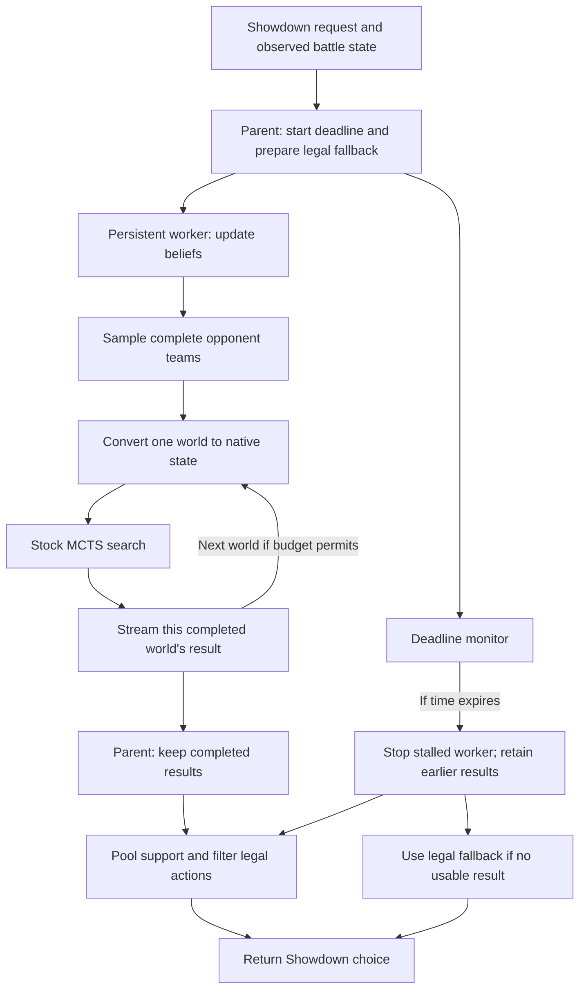

# Kenar's live MCTS walkthrough

> **25 October user decision:** MCTS is now the default development backend (8 worlds, 150 ms/world, one thread). The evaluation arms explicitly retain one-ply for fair comparisons. Earlier default recommendations and measurements below are historical; the promotion is a user choice, not a new strength result.

This walkthrough was maintained alongside `Kenar-mcts`: what changed, why each part exists, and what the evidence says. Numbers below refer to completed, checked runs. The bounded pilot and final checks are complete; the larger future study is explicitly separate.

**Current position:** the alternative MCTS backend, bounded pilot, prediction workstream and final deadline hardening are implemented and verified. Eight-world MCTS won three of four games against the retained agent. The user has chosen MCTS as the default development direction; the small sample still leaves its strength uncertain. The separate prediction model loses to the simpler HP baseline on the main test scores. The first measured implementation is [`46885bd`](https://github.com/saliha006/OxHack-2026/commit/46885bd); [the branch](https://github.com/saliha006/OxHack-2026/tree/Kenar-mcts) carries the final bookkeeping hardening and results. The [complete measurement report](mcts-results.md) collects the reproducible evidence behind this walkthrough.

## 1. The decision we are trying to improve

The old agent asks: **"After this turn, which action leaves me with the best position?"** It simulates our action against possible opponent actions, across a few guesses about the opponent's active set, then scores the resulting positions using the existing HP/alive-Pokémon heuristic.

That makes immediate attacks and healing easy to value. Setup can be harder: Swords Dance uses a turn without immediately removing HP, but can create much stronger attacks afterward. A single-turn evaluation has little room to discover that payoff. This explains the motivation for deeper search; it does not establish that any particular setup move is good.

MCTS asks: **"When I explore continuations after this action, which choices keep looking useful?"** Repeated search iterations explore future turns and revisit promising branches. Setup, recovery, Protect and switches enter the search whenever the engine represents them as legal; the old single-turn evaluator does not prune those options first. This branch calls stock `poke-engine` MCTS; we did not implement a second battle simulator or replace its native evaluation with a learned model.

The public entry point remains [`Agent.choose(request, battle)`](../decision/agent.py). Use `Agent(priors, backend="mcts")` to select the new path, or `Agent(priors)` for the retained `one_ply` path. Team preview still uses the established lead picker. Both backends share the belief and adapter corrections, so their decision rules are compared using the same corrected inputs.

## 2. A search needs a concrete world, but Pokémon hides information

At team preview we know the six opposing species. We generally do not know their complete moves, items, abilities, EVs, nature or Tera types. A search engine needs concrete choices for those details before it can simulate future turns.

The belief layer maintains candidate complete sets and weights for each opposing Pokémon. A **world** is one sampled complete set for every opposing slot. For example, two worlds can agree that the opponent has Gholdengo but disagree about Choice Scarf versus Leftovers and the associated moves/spread.

The first version samples each teammate independently using the current weights. It now samples the bench too. A guessed set for an unseen switch-in can change whether an apparently safe attack is useful. Teammate-conditioned priors are a separate, deferred improvement.

Observed facts constrain every world. A revealed move stays in the set; an observed item or ability overrides a guess; known Tera information is preserved. Sampling records are retained so we can inspect what the agent actually searched. See [`Belief.sample_worlds()`](../decision/belief.py).

## 3. What "search support" means

The **root** is the position we are choosing from right now; its actions are the moves and switches available now. MCTS returns how often it visited each root action. We normalise those counts **inside each world**, then average the resulting action distributions across usable sampled worlds.

Suppose one world gives an attack 80% of its visits and a second gives it 20%. Their pooled support is 50%. That stays true even if the first world completed 10,000 iterations and the second completed 1,000. Faster worlds should not silently get more influence just because they were cheaper to search.

Sampling already draws likely worlds more often. Each sampled occurrence therefore gets equal weight. Multiplying by its prior probability again would count that likelihood twice. Explicitly enumerated scenarios use a separate weighted aggregation mode.

The result is **search support**, not a calibrated probability of winning. “Attack has 70% support” means the pooled searches put 70% of their visit mass there. It does not mean the battle is a 70% win. The final policy maps engine choices into Showdown action slots, removes unsupported or illegal choices, renormalises, and chooses the highest support with a stable tie-break. See [`search_policy.py`](../decision/search_policy.py).

### One real turn, read from its trace

In decision `battle-gen9ou-22:2`, our Tinkaton faced the opponent's Tinkaton on turn one. Air Balloon and Mold Breaker were already observed. None of the opponent's moves or its Tera type had been revealed. The single searched world completed those missing details with Gigaton Hammer, Stealth Rock, Encore and Thunder Wave, Water Tera, and a Jolly attack/speed spread. Those additions are the concrete hypothesis searched, not newly discovered facts.

The highest supported choices were Gigaton Hammer (`move 1`) at 26.86%, switching to Ting-Lu in request party slot six (`switch 6`) at 15.99%, and switching to Hydrapple in party slot three (`switch 3`) at 8.88%. The agent chose Gigaton Hammer because it had the greatest support. The fairly spread distribution tells us the search did not put nearly all its visits on that action. It does not provide a 26.86% win forecast.

The full cold-start decision took 729 ms even though its requested native search was 150 ms. That extra time includes worker startup and preparation. Later decisions reuse the worker. This is why the trace records requested search time and total decision time separately.

### What changes when both backends receive the same position?

An offline comparison now gives both backends the same eight saved request/state inputs. Each backend starts with fresh beliefs, so this measures counterfactual choices from those inputs rather than exactly reproducing the original battle history. MCTS uses eight 150 ms worlds. All 16 returned choices were legal and all 64 MCTS worlds were usable, with no fallbacks. The backends disagreed on six of the eight positions.

| Saved position | One-ply choice | Eight-world MCTS choice | MCTS support for its choice / one-ply's choice |
|---|---|---|---:|
| Turn 30: Hydrapple at 100%, opposing Tinkaton at 63% | Draco Meteor + Tera | Nasty Plot | 39.99% / 1.91% |
| Turn 4: Tinkaton at 73%, opposing Ting-Lu at 87% | Switch to Zapdos | Stealth Rock | 48.40% / 8.27% |
| Turn 1: Tinkaton mirror | Gigaton Hammer + Tera | Gigaton Hammer, keeping Tera | 24.35% / 3.42% |
| Existing Kingambit fixture | Kowtow Cleave + Tera | Swords Dance | 40.70% / 2.60% |

The first and last rows make the motivation tangible: this search is willing to spend the current turn increasing future attack strength. Stealth Rock invests in future switch damage. The mirror example shows that using an attack and spending Tera are separate choices. In other saved positions, both backends chose Roost or the same forced Ting-Lu replacement, so the difference is not simply “MCTS always sets up.”

**None of these comparisons measures the outcome after the alternative moves.** A disagreement and its visit shares explain what the implementations preferred; they do not prove which move was stronger. The selection method was frozen before these new searches, and the [comparison artifact](../evaluation/mcts-position-comparison.json) records every input and result. No Protect-available position was found in this particular eight-position selection, so this experiment supplies no worked Protect comparison.

This offline analysis briefly overlapped the running pilot. Its UTC start/end window is recorded so latency under shared CPU load can be interpreted honestly; it is not an isolated throughput benchmark.

## 4. Why the worker process matters as much as the search

A battle bot must return a choice even when native code stalls or crashes. A Python exception handler alone cannot stop a stuck native call or contain an OS-level native crash. The parent therefore keeps a cheap legal fallback ready while a separate persistent process performs belief replay, state preparation and search.

The starting pooled settings are eight sequential worlds, 150 ms requested native search per world, one engine thread, and a three-second decision budget. The parent stops search at approximately 2.7 seconds, keeping about 300 ms to map and return the choice. Preparation is inside this deadline too. Eight times 150 ms is 1.2 seconds of **requested** search, not a promise that the whole decision takes exactly 1.2 seconds.

Every completed world is sent immediately. If world six stalls after five successes, those five successes remain usable. Worker startup, large search requests and partially sent result frames also have bounded parent waits.

An independent review identified one additional deadline edge after selection: the parent tells the worker which action it chose so the next turn's belief update can replay the right action. That bookkeeping notification, and invalidation after a rejected choice, now use bounded sends too. The worker already retains the request, so the notification only needs the compact action. If it cannot complete, the parent keeps the selected legal action and records lost replay history. The pilot remains pinned to its earlier source snapshot; this later bookkeeping hardening was verified with targeted stall tests and a separate final-code game, preserving the distinction between measured versions.

That final eight-world smoke game won in 52 turns. All 424 requested worlds were usable, with zero fallbacks, rejected choices, bookkeeping errors or lost replay records. Its maximum decision time was 1,977 ms. [The final-code smoke artifact](../evaluation/mcts-hardened-smoke-20261025.json) records source SHA256 `1fe6ef76f764428da9ff78da5d1fae0717ef1d32e8795abcd84bf2796ff0ced6`, separately from the pilot's `f182…` source. Winning one smoke game verifies integration; it is not a strength claim.

If the worker is replaced, accumulated soft inference in its memory is lost. The next observed snapshot restores confirmed revelations. The trace explicitly records this reset. See [`search.py`](../decision/search.py).

## 5. Belief fixes: certainty and uncertainty need different treatment

**Confirmed revelations are hard constraints.** If the opponent showed Trick, a candidate without Trick cannot return merely because other candidates received low likelihoods.

**Damage and speed are noisy evidence.** HP rounding, incomplete observations and modelling limitations can make a plausible set appear inconsistent. A small likelihood floor reduces its weight rather than destroying the distribution. The floor applies after the hard revelation filter.

The recovery paths now say why they were needed. They cover missing species priors, forme aliases, no surviving candidates and failed native evidence replay. An emergency estimate preserves known facts but can contain a neutral spread and a Tackle placeholder where information is missing. The trace exposes that approximation; it is not presented as a real OU set.

One concrete legality correction: Choice Scarf plus Trick is valid. Choice items lock move selection; they do not forbid a set from containing status moves. Assault Vest prevents selecting status moves. Treating both the same had removed legitimate candidates.

## 6. The adapter can determine whether search is meaningful

The adapter translates the observed battle into the engine's representation. Deeper search magnifies mistakes here: if it thinks Tera is still available after it was spent, it can plan a future that cannot happen.

Native checks now cover active PP and disabled moves, Choice/Encore restrictions, trapping, living-pivot and fainted replacements, reordered team slots, and spent Tera retained even on a fainted teammate. The adapter also carries supported delayed and persistent effects, including Wish and Future Sight.

Some fields remain estimates. Opponent PP and our bench PP are not fully observed; Substitute HP and extended screen/weather durations can be uncertain. These approximations are recorded. The native binding's volatile-counter documentation also proved misleading: Taunt and Yawn needed elapsed counters in particular valid ranges, rather than the apparent remaining-duration interpretation. Native simulation tests caught and verified that correction.

The detailed boundaries are in the [adapter audit](mcts-adapter.md). MCTS can only be as useful as the state it searches.

## 7. How to read the measurements so far

The clean single-world integration comparison used the same stand-in team on both sides and swapped sides across two games. Each MCTS decision requested one 150 ms world.

| Completed evidence | Result |
|---|---|
| MCTS versus retained one-ply agent | 1 win, 1 loss |
| Games and recorded sides | 2 games; MCTS played p1 once and p2 once |
| MCTS decisions | 141, including two team-preview choices |
| Requested / completed / usable search worlds | 139 / 139 / 139 |
| MCTS fallback choices / rejected choices | 0 / 0 |
| Pooled MCTS decision latency, p50 / p95 / p99 | 181.8 / 209.1 / 528.1 ms |
| Per-game MCTS p99 decision latency | 370.1 ms and 406.9 ms |
| Completion verification | Both new battles finished; summaries matched their exact tags |

**This establishes integration, not stronger play.** A 1–1 result over two games has a very wide win-rate interval, approximately 9.5%–90.5% at 95% Wilson confidence. It gives no reasonable basis to change the default backend.

The raw game records are in `runs/mcts-final-gate/eval/`. Each result links the two agents' preserved requests, states, decisions and subsequent observations. The execution used a frozen source copy, with source SHA256 `f182c3b0e26228d90e25ff94f011e1aa94d1124e98abe6fd0f95556d075a2692` retained in the manifest. Pooled percentiles are computed from all individual decision times, rather than averaging per-game percentiles; startup outliers make that distinction matter here.

### Completed pooled and ablation pilot

The pilot finished all 24 scheduled games: four games for each of the six comparisons, on two reserved offense/bulky-offense teams, with four concurrent games and a three-second decision ceiling. Every pairing used each team twice and placed each arm on p1 twice and p2 twice. [`evaluation/mcts-pilot.json`](../evaluation/mcts-pilot.json) records the settings; [the result package](../evaluation/mcts-pilot-20261025/) contains the manifest, per-game records and aggregate report. The larger 200-games-per-comparison configuration remains available separately; this bounded pilot is not being described as that confirmatory evaluation.

| Comparison | Completed result | What remains uncertain |
|---|---|---|
| Eight worlds versus current one-ply | MCTS won 3/4 | 75% observed wins; 95% Wilson interval **30.1%–95.4%**, still including 50% |
| One × 1200 ms versus eight × 150 ms | 2–2 | No preference established at equal requested total search time |
| One × 150 ms versus eight × 150 ms | Eight worlds won 3/4 | Additional worlds also received eight times the requested search compute |
| Whole-team versus active-only hidden-set sampling | Whole-team won 3/4 | Four games cannot establish the value of bench uncertainty |
| Soft belief updates versus hard-filter-only beliefs | 2–2 | No strength benefit established for the extra inference |
| Our eight-world agent versus Foul Play | 2–2 | Both sides were exercised, but their search budgets and world policies differ |

The runtime measurements are more informative about reliability than these small win counts are about strength:

| Pilot reliability measurement | Recorded value |
|---|---:|
| MCTS decisions, all MCTS arms combined, including 40 previews | 1,288 |
| Requested / completed / usable native worlds | 7,863 / 7,863 / 7,863 |
| MCTS fallbacks / rejected choices / failed worlds | 0 / 0 / 0 |
| MCTS decisions above three seconds | 0 |
| Eight-world arm p50 / p95 / p99 latency | 1,367.0 / 1,435.7 / 1,979.0 ms |
| Largest MCTS decision time across all arms | 2,054.3 ms |

The eight-world latency row pools the 747 decisions made by that arm across its matchups. Startup and the current desktop/development load are included. One short offline position analysis overlapped the pilot; [environment metadata](../evaluation/mcts-environment.json) records that limit. These are practical observations under shared load, not isolated hardware benchmarks. The measured source is the frozen `f182…` snapshot; subsequent bookkeeping hardening has its own tests and smoke evidence. Independently recomputing the checked-in `46885bd` production-source hash matched that frozen hash.

A [one-position native thread experiment](../evaluation/mcts-thread-benchmark-20261025.json) repeated the search five times each at one, two and four threads. All chose Swords Dance without fallback. Median visits rose from 18,000 to 34,000 to 57,000, while median native search time was 165, 174 and 196 ms. More threads produced more search work inside a world; they did not divide sequential wall time by the thread count. The default remains one thread, and this test does not establish playing-strength differences.

**The earlier evaluation recommendation was to retain `one_ply` as default; the user has now chosen MCTS as the development default while keeping one-ply for comparisons.** The pilot supports a working, deadline-safe integration under the tested conditions. It leaves strength, the best allocation of compute, and the value of the ablations uncertain. Even a 3–1 result has a broad interval here. A fresh larger evaluation is still needed to substantiate a strength improvement.

Several harness fixes were necessary before these numbers were usable: spawned evaluator processes avoid inheriting poke-env's event-loop thread; separate trace directories prevent mirror players overwriting each other; late messages cannot reopen and truncate finished files; fresh account names avoid reconnecting to old unfinished games; and the scheduler waits for the actual new battle and its matching summaries rather than trusting challenge-coroutine completion. Earlier interrupted or invalid harness runs are debugging evidence, not strength results.

## 8. Why prediction is a separate workstream

Choosing an action and estimating a calibrated win probability are different outputs. Search visits do not automatically give a calibrated forecast. **Calibration** asks whether positions assigned, for example, a 70% win probability actually win about 70% of the time across many cases. A model can rank who is ahead reasonably while still being overconfident about the percentages.

The prediction model therefore uses observed `BattleState` features through one shared training/serving featurizer, trains logistic regression, and fits a rescaling of its probabilities using validation battles only. The test battles are kept separate from both fitting steps. This model is not plugged into MCTS.

A fixed sample of the first 100 public Gen 9 OU replay listings produced 96 eligible games and 2,517 observed turn states. The chronological split is 67 training games, 14 validation games and 15 test games. No game's turns cross those boundaries. Repeated players and preview-roster team proxies are audited; the strict unseen test subset has only five games, so it is particularly small. Public ladder metadata does not prove every participant is human.

| Model, main chronological test | Log loss ↓ | Brier score ↓ |
|---|---:|---:|
| Constant 50% | 0.6931 | 0.2500 |
| HP-only baseline | **0.6348** | **0.2215** |
| Raw logistic regression | 0.7009 | 0.2406 |
| Validation-calibrated logistic regression | 0.6600 | 0.2338 |

Both metrics reward accurate probability predictions, and lower is better. Log loss heavily penalises confident wrong predictions. Brier score is the average squared difference between the predicted probability and the eventual zero-or-one outcome. Calibration improved this logistic model, but the HP baseline still performed better on both main test scores. The useful result is a reproducible training/evaluation pipeline and an honest failed improvement attempt, rather than a learned-model strength claim. Source hashes, model and metrics are in [`evaluation/prediction-public-20261025/`](../evaluation/prediction-public-20261025/).

Belief scoring separately asks whether pre-reveal candidate distributions assign probability to what is revealed next, compared with the original prior and a hard-filter-only baseline. Opponent-action scoring compares retained opponent visit shares with uniform over available native options. Unknown replies, including a faint before acting, are excluded rather than invented.

The two clean integration games have [recorded diagnostic scores](../evaluation/prediction-bot-gate-20261025.json):

| Diagnostic on these bot games | Measured result | What it says |
|---|---|---|
| Next-reveal log loss over 65 revelations | Prior 1.5131; hard-filter-only 1.5022; updated 1.5592 | Updated inference was worse on this tiny sample; do not claim a belief-quality improvement |
| Opponent reply log loss over 124 observed replies | Visit shares 2.0970; uniform 2.5242 | Visits assigned more support to observed replies here; this is not a calibrated opponent model |
| Reply exclusions | 15 unknown replies and two team-preview replies | Missing root actions were not invented |
| Full hidden-set coverage | Not measured | No ground-truth complete sets were supplied to this scoring experiment |

These scores use smoothing of `1e-6`. A move-revelation score assumes a uniform next new move within each candidate set; that assumption is explicit rather than an observed player policy. This evidence is labelled **bot**, separately from the public-ladder win-probability experiment. Five observed replies fell outside the engine's recorded native options and received the reserved unseen-category probability; those misses remain visible in the result.

The completed pilot supplies a larger, still diagnostic check. Its [611 next-revelation examples](../evaluation/prediction-bot-pilot-beliefs-20261025.json) scored 2.7074 log loss for the original prior, 3.0745 for hard filtering and 3.0773 for the recorded posterior. This metric supplies no evidence of a belief-quality improvement. It pools several experimental arms, so it does not isolate every change to soft damage/speed inference.

For [927 observed pilot replies](../evaluation/prediction-bot-pilot-actions-20261025.json), opponent visit-share loss was 2.8223 versus uniform 3.5420. The scorer separately excluded 350 unknown replies, 44 previews and 80 cases without predictions, and smoothed 107 replies outside the recorded native options. Four external Foul Play logs were excluded from belief scoring because they do not supply our exact posterior trace schema. These measurements remain bot-game likelihood diagnostics, with no claim of calibrated human-opponent prediction.

## Current status and what remains

- **Implemented and pushed:** backend flag; isolated deadline worker; whole-team belief sampling; legal visit pooling; structured recovery and approximation traces; essential/persistent adapter coverage; reproducible comparison harness; separate prediction training, serving and scoring tools. The first pushed implementation is `46885bd` on `Kenar-mcts`.
- **Measured:** the clean two-game single-world integration gate; all 24 pooled/ablation/Foul Play pilot games; same-input counterfactual choices; one/two/four-thread native measurements; gate and pilot belief/reply diagnostics; the public-replay prediction experiment; and a final-code eight-world game after bookkeeping hardening.
- **Verification:** the final combined decision/bot/data suite passed **402 tests**, with one credential-dependent Tiger integration test skipped. A subsequent fix to scoring mixed Agent/external-opponent traces passed all 20 focused prediction tests. Automated checks complement the actual native and live-game evidence; they do not measure playing strength.
- **Baseline delivery:** implementation, bounded evaluation and final hardening are complete. The larger confirmatory study remains separately configured and **was not run**. Native mechanics/hidden-state limitations remain explicit, rather than being silently treated as resolved.
- **User decision now in force:** MCTS is the default; `one_ply` remains an explicit comparison arm. The trained prediction model remains experimental and separate from search.
- **Limits to remember:** native mechanics and hidden-state estimates remain imperfect; teammate sets are sampled independently; native search is not deterministic; small game samples cannot establish strength; Foul Play's own world policy and requested compute differ and must be reported explicitly.

The [measurement report](mcts-results.md), [original plan](mcts-plan.md), [implementation notes](mcts-implementation.md), and [evaluation procedure](mcts-evaluation.md) provide the full detail behind this walkthrough.
